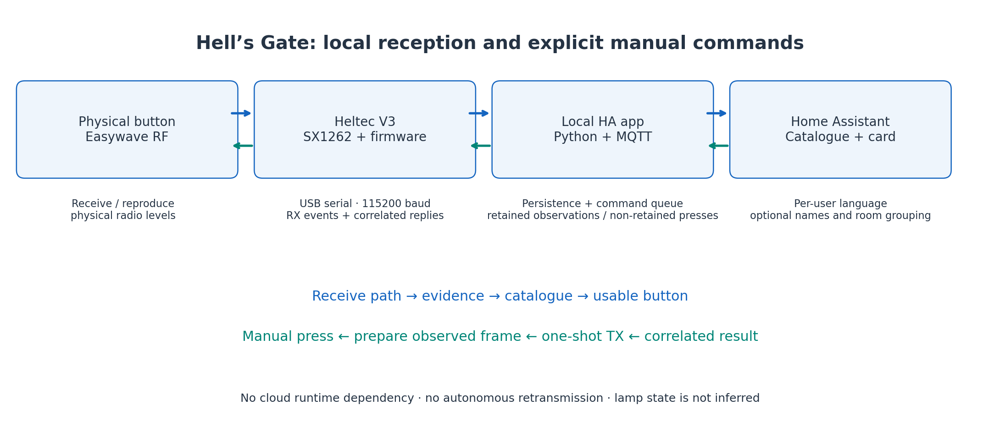
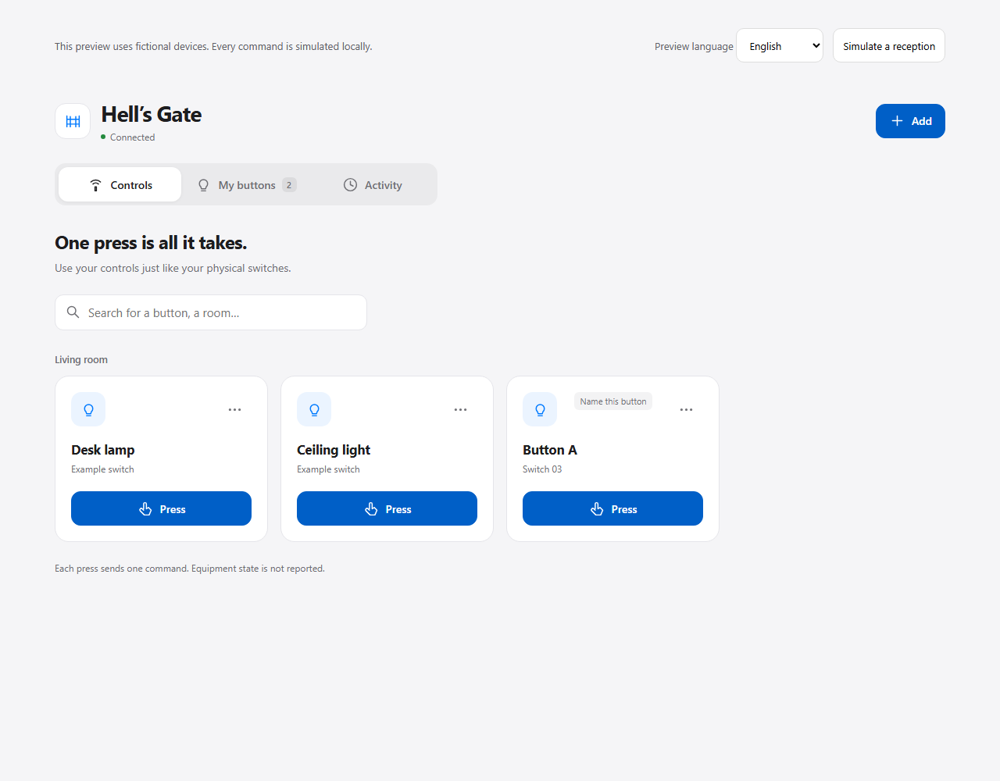
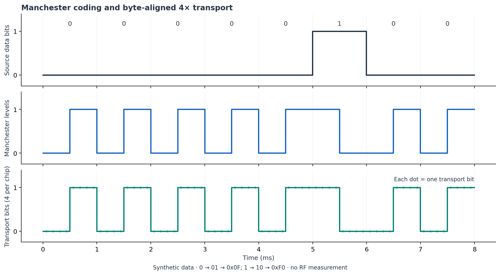

# Hell's Gate: Nikobus and Easywave integration for Home Assistant

Hell's Gate connects compatible Easywave wall switches and an existing Nikobus
installation to Home Assistant. It uses a Heltec WiFi LoRa 32 V3 board
(ESP32-S3 / SX1262), a local Python/MQTT bridge and an HA dashboard card.
The radio runs in 868 MHz FSK mode.

The open-source firmware receives, decodes and reconstructs the studied Easywave
frames directly on this general-purpose board. No ELDAT RX09/RX11 or other dedicated Easywave transceiver
is needed on the HA side. The aim is to use readily available hardware and reduce
the cost of connecting an older installation to HA.

For commands into Nikobus, the existing Niko 05-300 RF interface remains the link
to the wired bus. You can also use a compatible button solely as an input for an
HA automation, without a Nikobus installation or a 05-300.



## Why I built it

I wanted to keep my existing switches and wiring, understand the radio traffic
and use the buttons with local Home Assistant automations. I also wanted to be
able to use a recognized button straight away, with names and room assignments
added later if useful.

On my installation, about 99% of button commands respond as expected. That is my
experience with this hardware, not a compatibility figure for other receivers.
The radio path has no output-state feedback: HA knows that it requested a command,
but cannot tell from that transmission alone whether a lamp actually came on.

## Using the buttons

The gateway discovers compatible button traffic and keeps a catalogue of received
identities. Recognized commands can be used directly from the dashboard. Names,
rooms and groups are optional.

A physical button can also trigger an HA automation for equipment outside
Easywave/Nikobus, through that equipment's own integration. Examples include
adjusting a thermostat or adding detergent to a shopping list. See the
[use cases and complete automation examples](docs/USE_CASES.md).

The card follows each HA user's language and regional settings. English, French,
Dutch and German are included, with English fallback for other languages.



The screenshots use fictional devices. Open [frontend/demo.html](frontend/demo.html)
locally to try the interface; its reception and commands are simulated in memory.

## Installation and documentation

Start with the [installation guide](docs/INSTALLATION.md) and
[compatibility notes](docs/COMPATIBILITY.md). Installation is manual and intended
for users comfortable with firmware builds, local HA apps and MQTT.

For day-to-day use, see [the button guide](SELF_SERVICE_COMMANDES.md),
[Nikobus interoperability and ON/OFF commands](docs/NIKOBUS_INTEROPERABILITY.md)
and [testing and limitations](docs/TESTING_AND_LIMITS.md).

For development, read the [architecture](docs/ARCHITECTURE.md),
[MQTT/serial reference](docs/PROTOCOL.md), [modulation notes](docs/MODULATION.md)
and [contribution guide](CONTRIBUTING.md). The [project history](docs/PROJECT_HISTORY.md)
explains earlier decisions; the [roadmap](docs/ROADMAP.md) covers planned virtual
transmitters and other work.

The [publication review](docs/PUBLICATION_REVIEW.md),
[source export scope](docs/PUBLICATION.md) and
[project description](docs/DISCOVERABILITY.md) document what is included in this
repository and how it relates to earlier projects.

## RF security

Captured button commands have been retransmitted and operated Nikobus circuits
on my installation. Someone with compatible radio equipment could reuse learned
commands against a receiver that accepts them, even if the home has no HA or
Internet connection. Repeated lighting operation is one possible consequence.
HA authentication and this gateway's transmission limits do not protect that
independent RF path. Read the [RF security notes](docs/SECURITY.md) before use.

## A quick offline development loop

```sh
python -m pip install -r addon/easywave_gateway/requirements.txt
python -m pip install websocket-client matplotlib numpy
python -m unittest discover -s tools -p 'test_easywave_*.py'
python tools/build_frontend.py
python tools/build_frontend.py --check
node --check frontend/hells-gate-card.js
python tools/generate_community_figures.py
```

Edit `frontend/src/card.js`, `card.css`, `i18n.js` and the JSON language packs,
then rebuild the single card resource. To build the firmware, run
`python -m platformio run -e heltec_v87`. This is the only firmware environment
in the public configuration and is selected by default.



## Current scope

The release contains V8.7 learned-command firmware, bridge 0.4.0 and card 0.4.1.
The release checks included 79 passing Python tests, browser/locale checks and
a firmware build. These software checks do not establish receiver compatibility
in another installation.

The firmware stores up to 32 learned frames. Learning a new command requires a
complete received frame, including its final bit. HA automations also depend on
MQTT, HA and the target integration being available; an optional online ordering
workflow would depend on its external service.

Production command tables and the app registry start empty. Fictional test
identities are kept separately in `tests/fixtures/`. Modulation figures are
synthetic illustrations generated from source parameters, not antenna measurements.

## Related Nikobus projects

[Easywave2MQTT](https://github.com/marcselis/Easywave2MQTT) connects HA to a
dedicated ELDAT RX09 Easywave transceiver. Hell's Gate puts reception and frame
reconstruction for the studied commands into open-source firmware on the Heltec.
That gives users an option based on a general-purpose radio board, with lower
hardware cost as a goal. Both approaches still depend on compatible receiving
equipment for the commands they send.

[Nikobus-HA](https://github.com/fdebrus/Nikobus-HA) takes another route, connecting
to the wired bus through PC-Link. The RF approach here keeps the existing 05-300
as its entry point into Nikobus.

## License and acknowledgements

Original code and documentation use the [MIT license](LICENSE). Dependencies
retain their own licenses; see [third-party notices](THIRD_PARTY_NOTICES.md).
This is an independent project, without endorsement from Niko, Easywave, Heltec
or Home Assistant.
