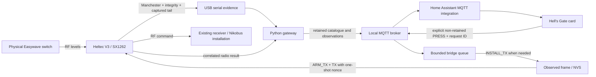
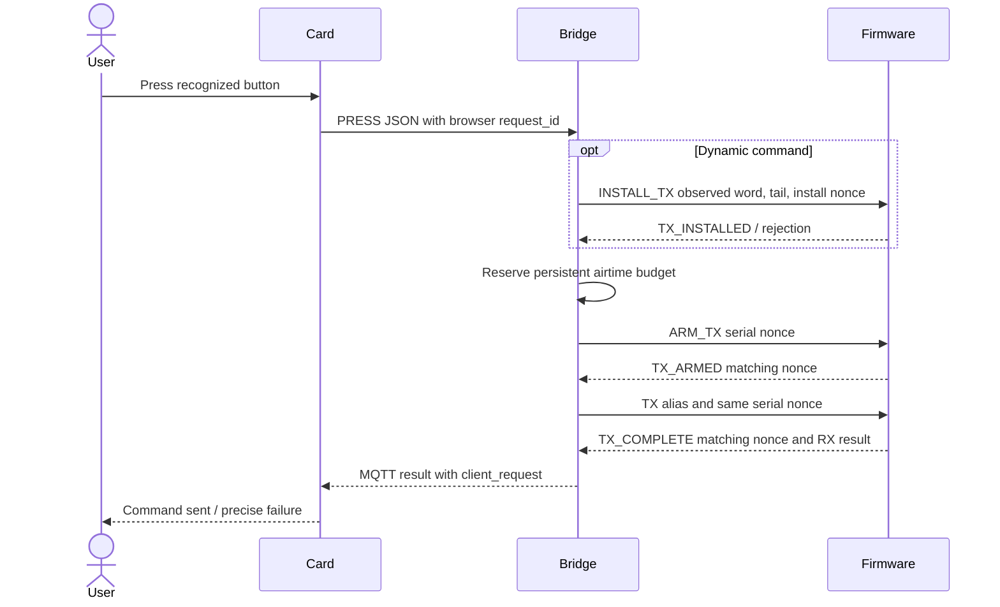
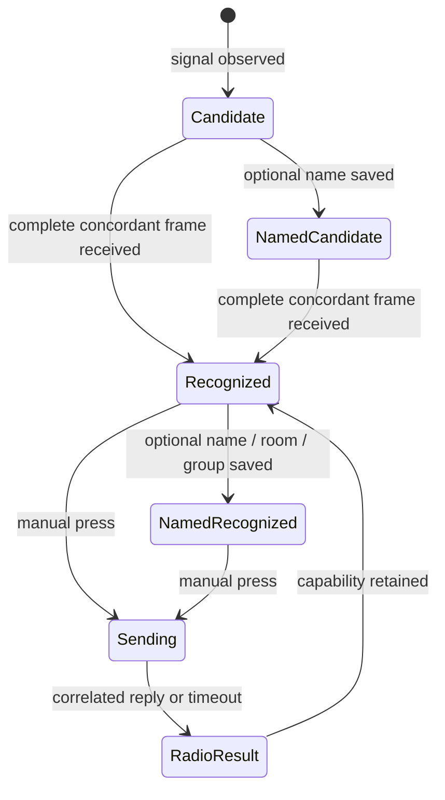

# Local Nikobus/Easywave pipeline architecture

Hell's Gate connects the Heltec radio to Home Assistant through a local MQTT
bridge. The bridge keeps received frames, optional labels and display groups
separate from transmission results. It does not infer the state of a physical load.

## Component responsibilities

| Component | Files | Responsibility |
|---|---|---|
| Firmware | `src/main_gateway_v8.cpp` | Configure the SX1262, scan RX profiles, validate observations, enforce one-shot TX and restore RX. |
| Captured-frame encoder | `src/easywave_learned_tx.h` | Retain the actual final bit and encode a complete continuous burst. |
| Offline transport reference | `tools/easywave_tx_frame.py`, `easywave_tx_continuous.py` | Model line coding, compare known references and generate timing/payload artefacts without RF I/O. |
| Runtime bridge | `addon/easywave_gateway/gateway.py` | Own serial access, MQTT discovery, observations, command queues and durable airtime accounting. |
| Labels | `addon/easywave_gateway/identification.py` | Store optional names/icons and resolve command capability from received evidence. |
| Catalogue | `addon/easywave_gateway/catalogue.py` | Join the data model, select one reference per group and apply atomic metadata requests. |
| Card | `frontend/src/card.js` | Handle navigation, local drafts, explicit presses and correlated feedback. |
| Presentation | `frontend/src/card.css`, `frontend/src/i18n.js`, `frontend/translations/` | Keep visual rules and per-user locale handling independent of RF logic. |
| Browser bundle | `frontend/hells-gate-card.js` | Deploy one generated local resource. No CDN or translation service is needed. |

## Data model

**Radio identity** is `SERIAL22_key2_side_variant`. The 22-bit serial comes from `word
>> 10`; the two-bit key field comes from `(word >> 8) & 3`. The side is the integrity
class recognized by the decoder. Those fields do not establish a wall position, room,
owner or physical target.

**Observation** adds the word, first/last reception, counters and, when available, the
actually received tail bit plus its confirmation count. An old 32-bit discovery is
enough to display a candidate; it is not enough to reproduce a new 33-bit frame.

**Labels** add the user's switch name, button name, room ID, icon identifier and
optional group. Naming does not change the identity or physical receiver pairing.

**Group** is a display association. Each group has one selected reference button;
pressing that group sends one command through that reference, rather than sending to
every associated identity. Room names come from HA's registry through stable `area_id`
values.

**Capability** is computed from native command definitions or complete received evidence
on compatible firmware. A recognized button is usable without a name, room, group,
activation flag or confirmation of the physical effect. The global gateway TX option,
connection status and RF budget still apply.

## Browser request ID and serial nonce

The browser request ID matches a result to the click that requested it.
A separate serial nonce correlates the one-shot firmware exchange. Neither ID
establishes that a lamp changed state. An unexpected serial RX/status line is still
processed while the bridge waits for a matching acknowledgement.

## Concurrency boundaries

The MQTT callback validates and enqueues work. The main bridge loop is the single serial
owner. Callbacks, browsers and other serial clients must not compete for reads. The
firmware IRQ signals that work is pending; packet decoding happens outside the ISR.

A form stays in its browser tab. Its save request contains the complete edit, identity,
expected metadata revision and request ID. The bridge validates a copy, persists once
and returns a correlated receipt. New receptions do not change the metadata revision. A
genuine concurrent edit produces a conflict with a recovery choice.

## State boundaries

The diagram stops at the transmission result. Confirming a lamp state requires
separate feedback or observation, including for ON/OFF commands and scenes. See
[the roadmap](ROADMAP.md) for planned work and the feedback limitation.

## Persistence

The app stores discovery, labels and airtime reservations under `/data`, with a
user-accessible mirror and bounded event log under `/share/heltec_easywave`. The
firmware stores installed learned frames in NVS. Access tokens, MQTT passwords and
browser drafts belong outside documentation and public example files.

The observation cache is separate from NVS: after a reboot, an old complete discovery
that was never installed may require a new physical press before the firmware accepts
installation. Installed matching entries are idempotent.

See the [message reference](PROTOCOL.md), [modulation notes](MODULATION.md),
[installation guide](INSTALLATION.md) and [test results](TESTING_AND_LIMITS.md).
The [security chapter](SECURITY.md) explains why request matching and TX limits
do not authenticate legacy RF commands. [Nikobus interoperability](NIKOBUS_INTEROPERABILITY.md)
covers third-party HA inputs, ON/OFF commands and output feedback.
