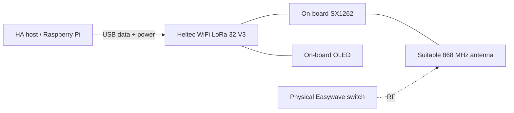

# Installing Hell’s Gate in Home Assistant

This guide covers a **local installation from source** using the
[Hell’s Gate repository](https://github.com/coldeg/hells-gate). Serial ports and entity
IDs below are installation-specific placeholders. Install the HA app locally and add
the card resource manually; this repository is not a HACS package.

## 1. Requirements

- A Heltec WiFi LoRa 32 V3 board with ESP32-S3 and SX1262, a suitable antenna and
  a USB cable that carries data. These are the board and modem used in this project;
  another ESP32/SX126x board needs its own pin and radio validation.
- A 64-bit Home Assistant OS installation able to run local apps, plus the
  MQTT integration and a local broker such as the official Mosquitto app. A
  Container installation needs separate container/serial/MQTT adaptation;
  the Supervisor-based `run.sh` is not a generic Docker entry point. Historical
  Core/Supervised installation methods are no longer supported by HA; see the
  [official installation comparison](https://www.home-assistant.io/faq/ha-vs-hassio).
- Local access to the apps/add-ons share and `/config/www`, a current HA backup,
  and a way to recover the board's existing firmware before replacing it.
- A development machine with Python, PlatformIO and the project's source. Node is used only for JavaScript syntax checks; the installed card does not need npm.
- A compatible physical transmitter/receiver that you own and can observe during
  a manual test. Review the applicable band, antenna and power constraints for
  the installation; source defaults are not certification.

Connect the completed Heltec board to the HA host by USB. The SX1262 and OLED are
already connected on the board; there is no need to add an external SPI wiring harness.



For board-porting work, refer to the actual pin map in `src/main_gateway_v8.cpp`: radio
NSS/DIO1/reset/busy are GPIO 8/14/12/13; OLED SDA/SCL/reset are 17/18/21; Vext is 36 and
the PRG button is GPIO 0. These are internal Heltec V3 connections, not an instruction
to wire arbitrary hardware to USB power levels.

## 2. Get and inspect the source

Download **Code → Download ZIP** from the repository, extract it and open a terminal
in the extracted directory containing `README.md`. Alternatively, clone it with Git:

```sh
git clone https://github.com/coldeg/hells-gate.git
cd hells-gate
```

Install PlatformIO in that source directory:

```sh
python -m pip install platformio
```

The production registry and firmware's native command table are already empty.
Use this reviewed source export. The fictional registry under `tests/fixtures/`
belongs only to offline tests; never copy it into the app. Existing installation
data and NVS are preserved during updates, so flashing is not a factory reset.
The first-install workflow assumes a new app data directory and a fresh board.

## 3. Build and install the firmware

```sh
python -m platformio run -e heltec_v87
```

The only published firmware environment is `heltec_v87`, selected by default. Keep
the existing V3 USB/UART behavior; changing USB CDC flags can make the expected serial
endpoint disappear. The public build pins the validated Espressif platform 7.0.1, RadioLib 7.7.1
and U8g2 2.36.18. Historical compile-time branches have been removed from this export.

After backing up the board and identifying its actual upload port, use the standard
PlatformIO upload operation on the development machine:

```sh
python -m platformio run -e heltec_v87 --target upload --upload-port <actual-port>
```

Verify the boot identity `NIKOBUS_HELTEC_EASYWAVE_GATEWAY_V8_7_LEARNED`,
`LEARNED_TX_SELF_TEST_OK` and `GATEWAY_BOOT_READY true` at 115200 baud. Then close the
monitor before starting the HA app: two programs must not own the same serial port. A
successful upload verifies neither reception nor physical receiver behavior.

Use the standard local PlatformIO commands above; no private household deployment helper is required.

## 4. Install the local HA app

Copy the **contents** of `addon/easywave_gateway/` into a local app folder named
`easywave_gateway` in HA's apps/add-ons share. On current Terminal images that share may
be mounted at `/local_apps`; other access methods expose `/addons`. Check the actual
mount instead of assuming both paths exist.

Refresh the local app store, find **Easywave Gateway**, build/install it and open its
configuration. The folder must contain `config.yaml`, `build.yaml`, `Dockerfile`, `run.sh`, the three
Python modules, `registry.json`, `tx_timing.json` and `requirements.txt`. The app
supports the listed `aarch64` and `amd64` architectures.

Identify the Heltec port through HA's hardware information and configure:

```yaml
serial_port: /dev/ttyUSB0  # Example only: select the actual Heltec device.
baud: 115200
tx_enabled: false
unknown_limit: 25
```

Start with global TX disabled while checking boot, reception and the broker. The app
obtains MQTT credentials from the Supervisor's MQTT service in memory; do not paste
credentials into documentation, the source registry or the card.

Configure HA's [MQTT integration](https://www.home-assistant.io/integrations/mqtt/) for
the same local broker and keep discovery enabled. The gateway device, its status,
catalogue and TX result entities should appear. A running broker must also be registered
as available in the Supervisor's service registry. See troubleshooting if logs say
`Service not enabled`.

## 5. Add the local card resource

Copy the generated `frontend/hells-gate-card.js` to:

```text
/config/www/hells-gate/hells-gate-card.js
```

In the dashboard's resource settings, add it as a **JavaScript module**:

```text
/local/hells-gate/hells-gate-card.js?v=0.4.1
```

Enable Advanced Mode in the HA profile if resource settings are hidden. Use one resource
entry for this card and update its version query after replacing the bundle, following
HA's [dashboard resource
documentation](https://contributors.home-assistant.io/frontend/custom-ui/resources/).

Locate the three actual entity IDs on the gateway device or in Developer Tools, then add
a manual dashboard card using [examples/dashboard.yaml](../examples/dashboard.yaml):

```yaml
type: custom:hells-gate-card
entity: sensor.replace_with_easywave_catalogue
status_entity: sensor.replace_with_easywave_gateway_status
result_entity: sensor.replace_with_easywave_tx_result
```

Replace every `replace_with_...` value. Entity IDs are assigned by HA and can retain
earlier prefixes; do not assume they are identical between installations. The current
card does not require a fixed list of five TX entities or a copied room list. An
existing `tx_entities` map remains compatible but is not needed for setup.

## 6. Receive, name and use a button

Choose either discovery workflow while global TX remains disabled:

- **Passive discovery:** leave the gateway and HA app receiving for about 24 hours
  while using the house normally. Only transmitters that actually emit during that
  period can appear; a silent button cannot be discovered by waiting. This is an
  observation period, not a background RF scan that polls or activates equipment.
- **Guided discovery:** press physical buttons one at a time. Use **Add** to see
  receptions during the session, or find them under **My buttons** among unnamed
  entries. Name a button, choose a room and optionally group it for convenience.

Discovery never transmits automatically. A complete recognized frame is directly
actionable when global TX is enabled; naming and adding metadata are optional.
An incomplete candidate offers **Recognize** and needs another physical press.
Nearby compatible transmitters may also appear: a received signal does not prove
ownership. Associate entries by controlled presses on your own equipment.

After a restart or candidate-cache turnover, a never-installed command may need a
fresh physical press before its first reproduction. Firmware has 32 learned-frame
slots; the observation catalogue and those persistent slots are different stores.

When ready to observe the load, enable the app's global `tx_enabled` option and restart
the app. Make the first radio test manually from the card while watching the intended
receiver. **Command sent** reports transmission; check the physical effect separately.
No per-button activation or confirmation step is required to make an otherwise
recognized button usable.

## 7. Language and regional formatting

The card uses the current HA user's profile language: `hass.locale.language`, then the
HA language, then the browser language, with English fallback when needed. The bundled
packs cover English, French, Dutch and German, including regional tags such as `fr-BE`
and `nl-BE`.

Formatting follows the profile's date order, 12/24-hour preference, number formatting
and local/server time-zone preference. Each card owns its locale state: two users can
use different languages at the same time. User-authored names, room names, icon
identifiers and radio identities stay unchanged.

Known bridge validation messages are translated at the presentation boundary. An
unexpected lower-level exception can retain its original diagnostic text; not every
upstream OS/library error is translated.

## Troubleshooting

| Symptom | What to inspect |
|---|---|
| Card is unknown | Resource path, module type, duplicate entries, browser reload/cache. |
| Catalogue stays empty | Actual catalogue entity ID, MQTT integration/discovery, app logs and serial ownership. |
| `Service not enabled`, or empty MQTT port | Supervisor MQTT registration. In the original installation I restored it by restarting the existing Mosquitto app, then the gateway; other MQTT clients briefly reconnected. |
| Serial device missing | Actual HA hardware path, USB data cable and board USB/UART build settings. |
| Recognize instead of Press | Complete concordant tail evidence, not just a historical 32-bit discovery. |
| Learning rejected after reboot | A never-installed historical frame may need a new physical press to restore the observation cache. |
| Learned-command memory full | Firmware currently has 32 persistent learned-frame slots; disabling old UI labels did not erase NVS. There is no finished per-entry deletion UI. |
| Command sent, load did not change | Full captured tail, physical pairing, receiver compatibility and RF conditions. TX completion does not establish physical success. |
| Old name or old screen | Metadata source, served bundle hash and resource version; reopen the mobile app after updating a cached resource. |

Preserve `/data` and the firmware's NVS during ordinary updates, back up before
replacing either, and keep a known-good card/app version for rollback. Do not erase the
board or reset discovery as a routine first troubleshooting step.
