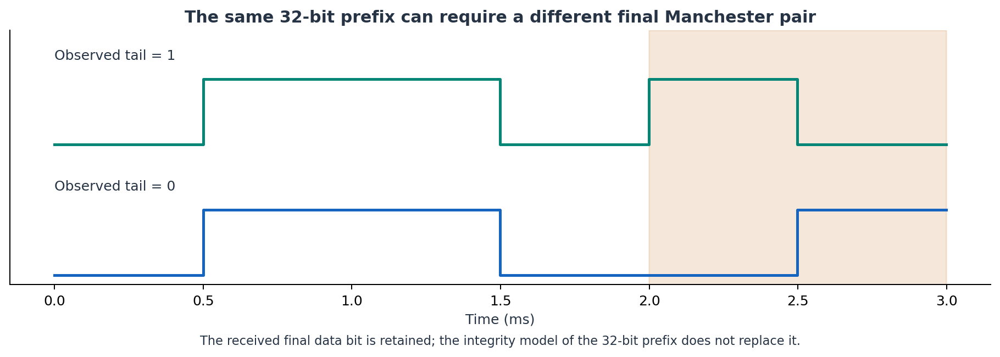
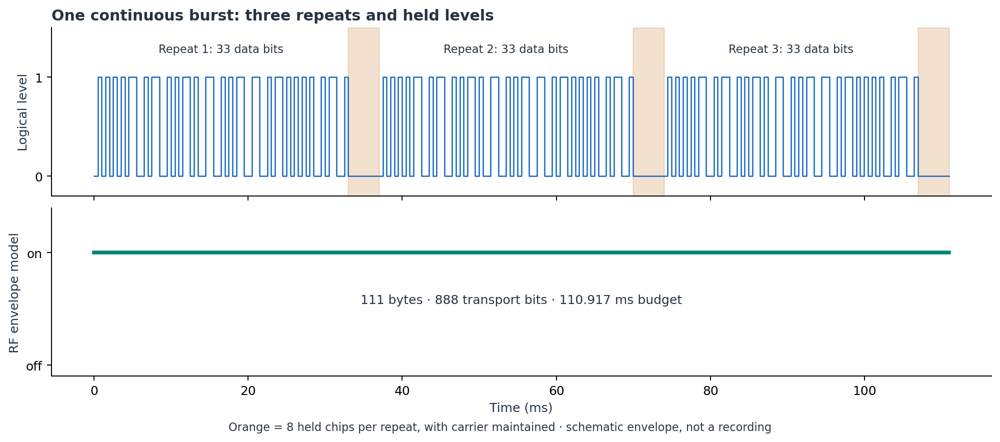
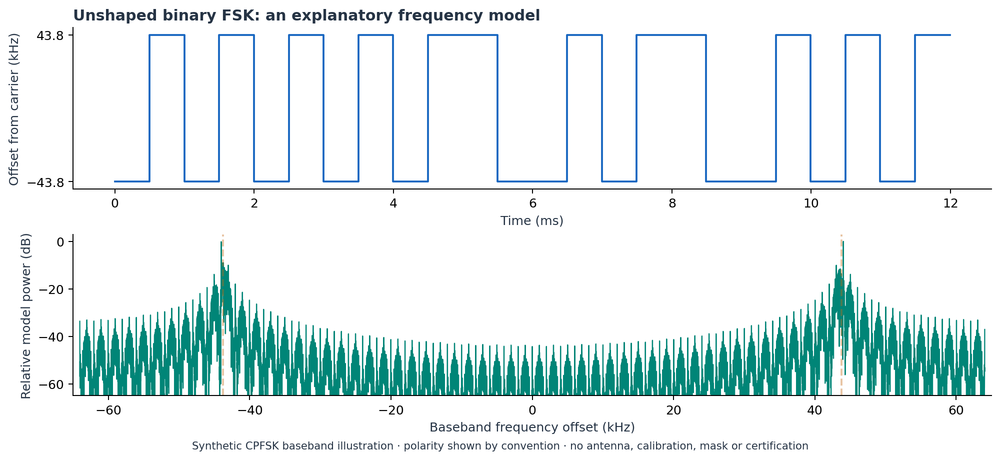

# Easywave FSK modulation and burst reconstruction

These notes explain how a received frame becomes Manchester levels, transport
bytes and a timed burst. The figures come from
[`tools/generate_community_figures.py`](../tools/generate_community_figures.py),
using source parameters and synthetic data. They are illustrations, not RF recordings.

## Terminology

| Term | Meaning in this project |
|---|---|
| Data bit | One source bit before Manchester coding. |
| Manchester chip | One of the two radio levels representing a source bit. |
| Transport bit | One modem input bit at the configured 4× transport rate. |
| Word | The 32-bit prefix used for identity and integrity processing. |
| Captured tail | The actual final source bit received after that prefix. |
| Frame data | 32 prefix bits plus the captured tail: 33 bits, encoded into 66 chips. |
| Hold | Eight additional chips at a constant level in the current burst model. |
| Burst | Three frame-and-hold cycles sent in one radio operation. |

## Implemented integrity model

Bytes are processed MSB first with polynomial `0x1D` and an initial CRC value of zero.
For a four-byte word, the last byte is compared with `crc8(first_three_bytes) XOR 0xB4`.
The primary class has residue `0x18`; the alternate class uses an additional `XOR 0x8E`
and residue `0x98`. These are observed implementation classes, not a claim to the
complete manufacturer's protocol.

The identity fields are derived as `serial22 = word >> 10` and `key2 = (word >> 8) & 3`.
Those numbers do not establish a physical up/down/left/right location. Structural
recurrence can make an observation interesting, but learned transmission still requires
a valid recognized frame with concordant captured-tail evidence.

## Manchester coding and the 4× packet transport


Source bit `0` becomes levels `01`, and bit `1` becomes levels `10`. Each Manchester
chip is repeated four times at the transport rate. One source bit therefore becomes one
complete byte: `0x0F` or `0xF0`. This makes 66 physical chips exactly 33 bytes without
inventing a partial hardware sync word or truncating the final chip pair.

The modem uses NRZ input; Manchester coding happens in software. The current continuous
TX path uses unshaped FSK, without hardware preamble, sync bytes or an extra hardware
CRC over the reconstructed bytes. The RX path uses software integrity validation and the
observed profile prefixes.

## Why the final captured bit is retained



The 32-bit integrity calculation does not establish the missing 33rd source bit. A new
learned command requires two concordant received copies with a tail of `0` or `1`. That
bit is stored with the word. The older fixed-command model and its historical tail
assumptions remain distinct from learned evidence.

A contributor investigating a failing load needs a full capture, not just a matching
32-bit prefix. A known received tail must not be replaced with an algorithmic guess.

## The continuous burst and its timing



The current reference values come from `tx_timing.json` and the offline transport
generator. V8.7 reuses the V8.6 continuous timing; the older identity in that timing
file describes the timing model, not the running firmware version.

| Quantity | Current reference value |
|---|---:|
| Source bit rate | 1,000.75 bit/s |
| Manchester chip rate | 2,001.5 chips/s |
| Transport rate | 8,006 bit/s |
| Transport bits per chip | 4 |
| Data bits per frame | 33 |
| Data chips per frame | 66 |
| Held chips per cycle | 8 |
| Cycles in one burst | 3 |
| Bytes in one cycle | 37 |
| Bytes in one burst | 111 |
| Transport bits in one burst | 888 |
| Rounded-up airtime reservation | 110,917 µs |
| Radio transmit calls per burst | 1 |

The nominal airtime is `ceil(111 × 8 / 8006 × 1,000,000)` microseconds. The configured
radio clock/register quantization and actual RF measurements are separate from this
nominal software budget. Airtime is reserved before attempting transmission, even when a
send later fails or its physical effect is unknown.

The held chips are included in the payload while the RF carrier remains active. They are
not an inter-frame radio-off interval. This distinction was central to replacing the
earlier multi-call burst experiments.

## Frequency modulation: what the picture means



The checked-in radio configuration uses a center of 868.314 MHz and a deviation of 43.8
kHz. The plot shows frequency offset around the carrier rather than a measurement of
absolute oscillator accuracy. The illustrative level-to-frequency polarity is a
convention; physical polarity still needs comparison with captures.

The lower plot applies a windowed FFT to a synthetic continuous-phase complex
baseband signal. It illustrates the two frequency states and their transitions.
It supplies no measurement of SX1262 spectrum, occupied bandwidth, ERP or receiver
response, and cannot establish regulatory compliance or a physical load response.

## Reproducing or improving the figures

```sh
python -m pip install matplotlib numpy
python tools/generate_community_figures.py
```

The generator saves both PNG and SVG figures under `docs/assets`, alongside
[`figure-parameters.json`](assets/figure-parameters.json). The generator verifies
payload size and airtime consistency and does not open a serial port, MQTT session or HA
connection. A synthetic serial and explicitly chosen illustrative tail keep household
recordings out of these plots.

For an improvement, provide the exact build, bit/chip convention, complete captured
frame, timing source, receiver context and a clear label separating a model from an
observation. Compare one changed variable at a time. Physical success requires
observation of the intended load; `TX_COMPLETE` alone is insufficient.
