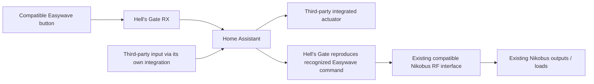

# Connecting Nikobus to a wider Home Assistant smart home

Hell's Gate uses the existing Nikobus RF interface to connect the installation to
HA. Its firmware receives and reproduces compatible Easywave commands; the
05-300 translates those commands into the wired bus. The HA-side radio runs on
general-purpose Heltec hardware with open-source firmware, avoiding a dedicated
Easywave transceiver on that side.

## Commands in both directions

| Direction | Path | What it enables |
|---|---|---|
| Existing wireless button → third-party equipment | Easywave press → Heltec RX → MQTT → HA automation → target integration | Reuse a button for a light, thermostat, cover, media action or other device outside the original cabinet ecosystem. |
| Third-party input → existing installation | Input's own HA integration → HA automation → Hell’s Gate TX → existing compatible RF interface → Nikobus load | Allow a different connected button or HA event to reproduce a recognized existing radio command. |

The [Niko 05-300](https://products.niko.eu/en/article/05-300) accepts compatible
wireless commands and passes them into Nikobus. Hell's Gate uses that RF input;
it does not turn a third-party actuator into a native wired Nikobus device.

An HA action targeting equipment outside Nikobus requires the target's own working HA
integration, without that Nikobus RF interface or a Nikobus output module. The reverse
path into an existing Nikobus installation retains its compatible receiver and
interface.

## Output-state feedback

Receiving a button press or completing a transmission records an event. Neither
reports whether the output is energized or a lamp is currently lit.

| Information | State classification |
|---|---|
| Physical button event received | Observed input |
| Radio API reported completion | Transmission result |
| Dedicated ON command sent | Requested state: ON |
| Dedicated OFF command sent | Requested state: OFF |
| HA retains the last requested state | Optimistic/estimated state |
| A suitable independent source reports the actual output | Measured/reported state, with the source identified |

An optimistic estimate must remain distinct from a measured state. An RF loss, another
wall button, a local override or a power interruption can make an estimate stale.

## Dedicated ON and OFF sides

Some Nikobus switching modules support separate ON and OFF inputs. For example,
the manufacturer's archived [05-000-01/02 switching-unit
manual](https://old.niko.sk/navody/Nikobus_system_inteligentnej_elektroinstalacie/05-000-02_Spinacia_jednotka.pdf)
describes M1 with two button points (upper ON, lower OFF), M2 as forced ON and M3 as
forced OFF. It also supports configurable reaction times for M2/M3. Verify the actual
module, its manual and the RF-interface mapping before applying those mode numbers to an
installation.

Niko's [05-340/05-341 Easywave receiver
manual](https://dam.nikocdn.eu/assets/Niko/Documents/Manuals/PM005-34000.pdf) also
documents a two-key ON/OFF mode, but do not assume that its complete programming
procedure or mode table applies to a different Nikobus module.

If the installed receiving/output configuration supports it, retain two distinct
recognized identities:

- Map the first to an explicit **ON** action.
- Map the second to an explicit **OFF** action.

Repeatedly requesting ON then keeps the same intended state, unlike a toggle that
changes meaning depending on the unknown initial state. That gives an HA script a consistent requested action, although confirming the
result still requires feedback.

Also check reaction time: Hell’s Gate currently sends a short bounded one-shot burst and
does not implement an arbitrary long hold. A module function requiring a sustained
one-to-three-second press must not be assumed to work with that burst. No installed
Nikobus module was reprogrammed and no new ON/OFF pair was verified as part of the
documentation work.

## Clear command semantics in HA

Receiver-side replay is independent of HA: an unauthorized compatible transmitter may
exercise the same RF input even in a home without HA. Dedicated ON/OFF semantics clarify
intent but do not authenticate commands. See [security](SECURITY.md).

Keep ON and OFF as separate scripts/actions backed by the actual recognized aliases,
with their physical meanings confirmed for the target configuration. Keep both button
identities available. The current group card selects one reference command; it does not
yet supply a dedicated paired ON/OFF widget or a stateful HA light entity. Such a
control first needs explicit command semantics, with any assumed state labeled
accordingly.

If actual state is important, investigate a supported feedback interface or a suitable
independent measurement for the circuit. A power reading can support an inference for a
known load, but it does not automatically prove the state of every lamp in a group.
Record the source and uncertainty of that information.

This lets you keep the existing Nikobus installation and add compatible controls
through HA. Other controlled devices use their own integrations.
