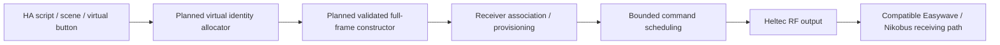

# Roadmap: virtual transmitters, scenes and integration limits

## Next radio research direction: virtual transmitters

The next research direction is a pool of HA-controlled virtual radio buttons, without a
physical transmitter for every command. A complete valid new Easywave identity/frame
would be constructed, then associated with the appropriate compatible
receiver/interface.

This is signal creation **ex nihilo**: a planned research and implementation step rather
than a feature shipped in the current gateway. The current learned-command path
deliberately requires a received complete frame or an identical already-installed entry;
it rejects a newly invented unobserved frame. That firmware behavior is unchanged by
this documentation work.

One radio endpoint could provide many software-defined controls without buying a
physical transmitter solely to obtain each command identity. This is a large command
pool rather than a literal infinity: the protocol namespace, receiver association
memory, gateway storage and available airtime are finite. Inventing an identity also
does not make an unpaired receiver accept it.

### Work requiring validation

1. Establish a complete frame-construction rule, including the actual final bit
   and supported integrity variants. Do not assume the existing 32-bit CRC model
   alone establishes all remaining protocol bits.
2. Allocate persistent virtual identities without colliding with known physical
   transmitters and keep their meanings stable across restarts and restores.
3. Validate pairing/provisioning with the actual receiving interface and output
   module. Document receiver capacity and supported command semantics.
4. Add an explicit virtual-command storage/API path rather than silently making
   the current learned-evidence path accept arbitrary frames.
5. Compare offline encoded plans with complete independent references before a
   separately observed manual RF test. Retain cadence, quotas and one-shot TX.
6. Expose virtual buttons and semantic actions cleanly in HA, with backup, deletion
   and migration behavior covered by tests.

## The principal limitation remains state feedback

**Creating more command identities does not create an output-state feedback channel.**
The Easywave-to-Nikobus path implemented here does not natively report the actual
Nikobus output state to HA. A requested command and radio result do not establish a
measured on/off state.

Three concepts remain separate:

- **Requested:** a command asks the output to turn ON or OFF.
- **Estimated:** HA remembers the last request or applies a model of likely state.
- **Confirmed:** a suitable independent feedback/measurement source reports the output.

This limitation applies to physical buttons, virtual buttons, scenes and scripts. It
concerns this radio integration; other Nikobus products or optional wired interfaces may
provide feedback. A separate feedback integration would be another project layer
requiring its own evidence.

## Scenes using recognized commands and future virtual inputs

HA scripts/scenes can already combine recognized commands whose intended physical
behavior has been verified. Virtual transmitters would expand the available command pool
after receiver association; they would not be a prerequisite for every scene.

| Scene | Actions to combine |
|---|---|
| Living-room all off | Send explicit OFF commands to the relevant legacy circuits and turn off the selected third-party HA lights. |
| Living-room ambience | Turn off the main/ceiling circuits and turn on the selected wall or ambient lights. Dim only targets that expose a validated dimming or preset action. |
| Full light in the house | Request ON for all selected lighting circuits and maximum brightness where the target actually supports brightness control. |
| Movie time | Choose a small ambient-light set, turn off distracting lights and apply the desired media/blind actions through their integrations. |
| Reading | Turn on a reading lamp and selected background lighting while leaving unrelated rooms unchanged. |
| Leaving / bedtime | Combine an explicit lighting-off script with other deliberately selected local HA actions. |
| Guest comfort | Expose a few clear scenes through a wall button without requiring the guest to open HA. |

Deterministic results require actual **ON/OFF or scene semantics**. A toggle with
unknown initial state cannot guarantee “all off” or “all on”. Where the actual module
supports a programmed scene or central command, one receiver-side action may be
preferable to sending a long list of individual RF commands. Verify that support on the
specific module instead of assuming all devices share the same modes.

Schedule multiple RF commands within the current one-shot interval and rolling budget,
account for partial failure and avoid presenting a multi-command scene as an
instantaneous atomic operation. A successful script means its requests ran; the actual
state of the entire house still needs feedback if that certainty is required.

## Other community directions

Security review is also required: virtual identities and scenes do not add
authentication or replay resistance to a legacy receiver. The [security
chapter](SECURITY.md) covers the demonstrated replay capability and misuse by
independent transmitters, with or without HA in the targeted home.

Useful next steps include improving learned-memory lifecycle management, distinguishing
failure reasons, broadening documented receiver compatibility, adding reviewed public
capture fixtures, extending translations/platform testing and making community packaging
independent of the original workspace. Practical entry points are listed in
[CONTRIBUTING.md](../CONTRIBUTING.md).
