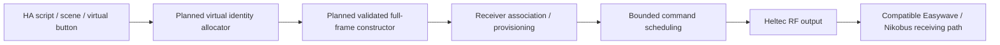

# Roadmap

## Virtual transmitters

The next radio research task is to create software-defined Easywave button
identities for HA, then pair them with compatible receivers. That could provide
more controls without buying a physical transmitter for each new identity.

This is planned work. The current firmware learns complete received frames;
it rejects a newly invented frame unless that exact entry is already installed.
Creating an identity will also require receiver association before it can
operate an output.

The number of controls will depend on the protocol namespace, receiver pairing
memory, gateway storage and available airtime.

Before this can be implemented:

1. Establish the full construction rule, including the final bit and integrity
   variants. The existing 32-bit CRC model does not settle every frame bit.
2. Allocate persistent identities that avoid known physical transmitters and
   survive restarts and restores without changing their meanings.
3. Test receiver association, command modes and capacity on the actual hardware.
4. Add a separate storage/API path for virtual commands, keeping learned-frame
   checks intact.
5. Compare encoded plans with complete independent references before manual RF
   tests. Keep one-shot transmission, cadence and airtime limits.
6. Add HA controls with tested backup, deletion and migration behavior.

## Output-state feedback

The implemented Easywave-to-Nikobus path does not report the real output state
to HA. Extra button identities will not supply that information.

The UI needs to distinguish a requested state from an estimate based on the last
command. A confirmed state requires a suitable feedback interface or independent
measurement, with its source identified. This applies to physical buttons,
virtual buttons, scripts and scenes. Other Nikobus interfaces may provide
feedback, but integrating one would be separate work.

## Scenes

HA scripts can already combine recognized commands with known physical effects.
For example, a living-room script could send OFF to legacy ceiling circuits and
turn on an HA ambient light. A bedtime script could combine lighting commands
with selected local HA actions.

Use explicit ON/OFF commands or a receiver-programmed scene where supported.
A toggle cannot reliably mean "all off" when the initial state is unknown.
Dimming, presets and central commands also depend on the actual receiver module
and its programming.

Multiple RF commands must respect the one-shot interval and rolling budget.
A scene can partly fail and its commands are sent in sequence. Completing an
HA script only confirms that its requests ran; actual house-wide state still
needs feedback if that certainty is required.

## Other work

The [contribution guide](../CONTRIBUTING.md) lists tasks around learned-memory
deletion/replacement, clearer failure messages, receiver compatibility, public
capture fixtures, translations and installation packaging.

Virtual identities and scenes will retain the legacy receiver's RF security
limits. The [security notes](SECURITY.md) cover replay by independent transmitters,
including when the target home has no HA installation.
