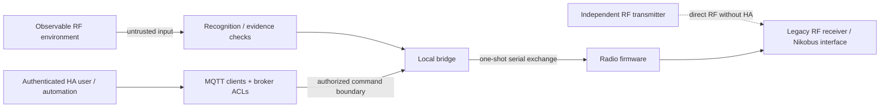

# RF replay and security

Captured Easywave button commands were retransmitted by Hell's Gate and operated
Nikobus circuits in the owner's installation. A compatible independent transmitter
could reuse commands from the studied frame family against a receiver that
accepts them. The target home needs no Home Assistant, MQTT or Internet connection:
the original receiver handles the reproduced RF command directly.

The tests covered the owner's equipment and the legacy traffic described in
[compatibility](COMPATIBILITY.md). No garage door, access-control device or
third-party installation was tested. The misuse examples below describe possible
consequences of replay, not attacks carried out by this project.

## Earlier work and incident reports

Easywave has a long history of legitimate use. Earlier HA projects include
[Easywave2MQTT, announced in January 2022](https://community.home-assistant.io/t/new-add-on-to-add-support-for-easywave-devices/385609),
using an RX09, and [Nikobus-HA](https://github.com/fdebrus/Nikobus-HA), using a bus
interface. Their existence does not establish that they performed the same
Heltec frame reconstruction or tested the same replay behavior.

Hell's Gate handles the studied RF commands on a general-purpose ESP32/SX1262
board with open-source firmware. This provides an alternative to a dedicated
Easywave transceiver on the HA side. It also means that this radio capability
is not confined to vendor interfaces.

The limited public-source search for these notes found no verified malicious
campaign against the specific Niko 05-300 path. The owner is not aware of one
either. Neither observation establishes how often abuse occurs or rules it out.

## Radio hardware and range

The tested receiver is the Niko 05-300. The Heltec board uses binary FSK near
868 MHz; its LoRa product name does not describe the modulation used here.

RF can travel beyond a room or property boundary. Interception range depends on
power, antennas, receiver sensitivity and surroundings. No maximum range has
been measured for this project. ELDAT quotes a typical 150 m open-field range for
its [RTS03](https://www.eldat.de/produkte/sender/rts03eC01_de.html); that is a product
specification, not a measurement of this Heltec setup.

An observable or documented protocol can still authenticate commands and reject
replay. Here, the relevant finding is that a captured command was accepted again.

## What the checks protect

| Mechanism | Purpose here | Limit |
|---|---|---|
| Manchester coding | Recover data from transitions. | Provides no encryption or authentication. |
| CRC/integrity class | Reject inconsistent or unrecognized structures. | Is not a cryptographic authentication code. |
| Transmitter identity | Associate traffic with a learned sender/button. | Can be observed and repeated. |
| Captured tail and matching copies | Preserve the complete received frame. | Do not establish freshness. |
| `INSTALL_TX` checks | Require observed evidence for new learned commands in this firmware. | Cannot restrict another radio. |
| Serial nonce | Match and bound a one-shot host/firmware exchange. | Is not added as authentication to the legacy RF frame. |
| Browser request ID | Match results and suppress recent duplicate UI requests. | Is not an authorization credential. |
| Non-retained `PRESS` | Prevent reconnecting MQTT clients from replaying retained commands. | Cannot stop deliberate RF replay or a compromised publisher. |
| Airtime/rate limits | Bound this bridge and firmware's transmissions. | Do not apply to independent transmitters. |

HA authentication, broker ACLs and serial request checks protect their respective
parts of this system. They cannot change the legacy receiver's RF acceptance.

## Possible effects of replay

A nearby transmitter could repeat a learned lighting command at night, disturbing
sleep or wasting energy. A toggle may alternate an unknown state rather than
reliably mean ON; repeated operation can still cause disruption. A transmitter
left within effective range would not require its operator to remain nearby.
These are plausible scenarios, not reported incidents from this project.

The effect depends on the receiver's actual mappings: a button may control lights,
blinds, heating or other equipment. With no independent output feedback, HA may
not show the physical state caused by an unwanted command.

The same RF input can trigger HA automations. Treat a received button identity as
input, not proof that an authorized person requested the action. Purchases, door
unlocking, alarm changes and safety-critical settings need independent
authorization. The shopping-list examples only add an item.

## Reducing exposure

Check which receivers accept this frame family and what their paired commands
control, including downstream HA actions. HA logs alone do not show every command
received directly by a legacy RF interface.

Where that exposure is unacceptable, the affected RF path needs to be disabled
using the equipment's supported procedure or replaced with a path whose command
authentication and replay resistance have been verified. Such installation work
requires the owner's agreement and appropriate expertise.

For HA actions, independent authorization, schedules or rate limits can reduce
particular consequences. State/power sensing and anomaly alerts can help detect
unexpected operation. Neither prevents an independent transmitter from commanding
a legacy receiver, and automatic corrective transmissions are not a security fix.

Stopping HA, disabling Hell's Gate TX, changing MQTT credentials or deleting a
learned entry will not stop replay at a receiver that still accepts the command.
Re-pairing alone is also insufficient if the new traffic remains replayable.

## Access controls and other critical outputs

Some Easywave-compatible products serve access-related uses. For example, ELDAT's
[RCL03 description](https://www.eldat.de/produkte/empfaenger/rcl03eB10_en.html)
mentions retrofitting a garage-door opener. That does not establish whether a
particular installation uses the frame variant tested here.

Check the exact receiver, configured function and authorization path before
using it for a critical output. Keep the device's independent interlocks and
physical protections. A replayable command should not be the sole authorization
for access.

Other product families need separate assessment. ELDAT documents
[secwave](https://www.eldat.de/secwave_en.html) with AES-128 and a telegram
structure incompatible with Easywave. This decoder does not support it.
Encryption, authentication and replay resistance are separate properties to check.

## HA, MQTT and host access

- Restrict MQTT clients to the topics they need. Disable anonymous access and
  protect broker credentials and network access.
- Use appropriate HA authentication and permissions. For remote access to this
  local setup, use a controlled private VPN.
- Limit serial access and firmware provisioning to trusted local processes.
  The bridge assumes a trusted serial endpoint.
- Keep credentials and household command data out of `/config/www`. Frontend
  files can be downloaded by clients that reach HA; private runtime state comes
  through authenticated HA access.
- Validate and bound unexpected RF input. Candidate-storage exhaustion and
  denial-of-service behavior still need adversarial review.

These measures protect the software and host path shown in the diagram. The
independent RF path remains.

## Source publication and private data

Public code and commodity hardware make this work easier to inspect and reuse,
including for purposes outside the project's intended use. License terms and
checks in this firmware cannot constrain someone else's transmitter.

The export excludes household captures, identities, command words, locations,
dashboards and flash/NVS backups. Synthetic figures and fictional screenshots
are used instead. Keeping those records private avoids exposing a ready-made
household command set, but does not repair replay acceptance at the receiver.
See [the source export scope](PUBLICATION.md).

Test only on owned equipment or with permission. Reports should identify the
model/build and separate observed results from possible effects. Keep actionable
household RF data out of public issues and follow the
[security-reporting policy](../SECURITY.md).

## Output-state feedback

Explicit ON/OFF commands, scenes and future virtual transmitters still need a
separate source to confirm output state. They also retain the receiver's RF
authentication limits. Keep requested state, estimates and measured state distinct.
