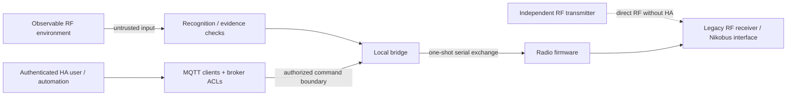

# RF replay, trust boundaries and critical devices

**Demonstrated: a command originating from an existing Easywave/Nikobus wall button can
be captured and retransmitted by this system, operating associated Nikobus circuits on
the owner's installation.** Any command learned in the supported replayable frame family
must therefore be treated as potentially reusable by an unauthorized third party with
compatible radio equipment.

**The targeted installation does not need Home Assistant, MQTT, Hell’s Gate or an
Internet connection.** The original compatible RF receiver accepts the reproduced button
command and passes it into the existing installation. An independent transmitter can
exercise that path without accessing the household's software or owning its original
button. HA is one integration layer used by this project; it is not a prerequisite for
the affected receiver to respond.

The replay capability and physical operation of several owner-controlled circuits were
demonstrated. The scope is the **traffic and receiver behavior studied here**; it does
not establish that every product sold under the Easywave name accepts the same frames.
No garage door, access-control device or third-party installation was replay-tested in
this work. Specific abuse scenarios below are inferred consequences of that demonstrated
capability, rather than attacks carried out by this project.

## Historical use, earlier work and incident evidence

Easywave has a long history of legitimate use. Public HA interoperability work
also predates this project: the author of
[Easywave2MQTT announced RX09-based reception and transmission in January 2022](https://community.home-assistant.io/t/new-add-on-to-add-support-for-easywave-devices/385609).
[Nikobus-HA](https://github.com/fdebrus/Nikobus-HA) documents another, bus-interface
integration path. These are earlier integration projects, not evidence that they
performed this same Heltec RF reconstruction or enabled the same identity replay.

Hell’s Gate implements the studied RF reception and reconstruction directly on a
general-purpose ESP32/SX1262 board, without a dedicated Easywave transceiver on
the HA side. This makes hardware independence part of both the interoperability
benefit and the threat model: replay capability is not confined to vendor devices.

The bounded public-source review for this documentation did not identify a verified
report of a malicious campaign against the specific Niko 05-300 path studied here.
That finding does not establish that no abuse has occurred or that every relevant
publication was found.
The owner is not aware of malicious use; that is an observation, not a security
guarantee or an estimate of attack prevalence.

The physical replay demonstration establishes a capability. Its existence should
be documented without presenting hypothetical nuisance scenarios as past incidents
or suggesting that every existing installation is currently being attacked.

## FSK at 868 MHz, not LoRa

The owner confirmed the **Niko 05-300 Nikobus RF interface** as the receiving path.
See [verified compatibility](COMPATIBILITY.md) for the studied legacy Easywave
scope and the distinction from wired Nikobus, Home Control, neo and secwave.

The board contains an SX1262, but this project uses binary **FSK**, around the
configured 868 MHz carrier, rather than LoRa modulation. A radio signal is not confined
to a room or property boundary simply because HA runs on a private LAN.

Interception range depends on power, antennas, receiver sensitivity, surroundings and
obstacles. The project has not measured a maximum interception range. For context,
ELDAT's [RTS03 specifications](https://www.eldat.de/produkte/sender/rts03eC01_de.html)
quote a typical open-field range of 150 m for that product; that is not a range
measurement or guarantee for this Heltec installation.

Observability is not the same as insecurity: an openly documented protocol can still be
secure. The relevant questions are whether a command is authenticated, whether freshness
is verified and whether an old valid command remains acceptable.

## What the observed frame does and does not prove

| Mechanism | Purpose here | Security boundary it does not establish |
|---|---|---|
| Manchester coding | Recover logical data from transitions. | Encryption or sender authentication. |
| CRC/integrity class | Reject inconsistent or unrecognized structures. | A cryptographic message-authentication code. |
| Transmitter identity | Associate a command with a learned sender/button. | A secret credential that cannot be observed and repeated. |
| Captured tail / concordant copies | Preserve the complete observed frame. | Freshness or replay protection. |
| INSTALL_TX checks | Prevent this firmware from preparing an unobserved arbitrary learned frame. | Preventing another radio from transmitting independently. |
| Serial nonce | Correlate and bound the host/firmware one-shot exchange. | An authenticated nonce in the legacy over-the-air frame. |
| Browser request ID | Match a result and suppress recent duplicate UI requests. | A secret, signature or authorization token. |
| Non-retained PRESS | Avoid accidental replay after MQTT reconnect. | Protection against a deliberate radio replay or a compromised authorized publisher. |
| Airtime/rate limits | Bound operation through this bridge and firmware. | A limit imposed on an independent nearby transmitter. |

The supported workflow does not add encryption or cryptographic anti-replay to the
legacy receiver. A better HA password, MQTT ACL or serial nonce protects its own hop; it
cannot change what that receiver accepts over the air.

## Repeated nuisance and unauthorized control are serious impacts

Consider a nearby person recording a household's compatible button traffic, then using
an independently programmed radio to repeat those commands at night. If the installed
receiver still accepts them, that person could repeatedly operate bedroom lighting
without a key, HA account, Wi-Fi access or access to the original transmitter. A
Heltec-class board is one possible platform, not a prerequisite. The person need not
remain present if a transmitter is left within effective range.

This is a plausible misuse scenario inferred from the demonstrated replay capability,
**not a reported incident or a test against a neighboring home**. Exact reach, affected
equipment and the resulting operation need model-specific evidence. A toggle frame may
invert an unknown state rather than reliably mean "turn on"; that uncertainty does not
prevent repeated disruption.

Repeated lighting operation can disturb sleep, cause distress, waste energy and
undermine trust in a home. Other mapped commands may operate blinds, heating or access
equipment. Assess the effect of each configured output; "only a light" is not a
sufficient reason to dismiss unauthorized repeated control. With no independent output
feedback, HA may also fail to show the resulting physical state.

The same concern applies to HA automations triggered by received RF: a repeated accepted
button event can trigger a third-party device or workflow. Moving the target outside
Nikobus does not make the original RF event authenticated. An RF button alone should not
authorize a purchase, unlock a door, disable an alarm or change a safety-critical
setting. Additional independent authorization belongs at the action boundary. The
shopping-list examples add an item; they do not place orders.

## Publication and dual use

Public source, protocol notes and commodity hardware can reduce the effort needed to
reproduce or adapt this capability, including for abuse. This project is useful for
interoperability and modernization, but its implementation can be modified; software
checks in this repository do not constrain someone else's transmitter. An acceptable-use
statement or a license is not a technical RF protection.

The receiver's acceptance of replayed commands is the underlying issue. Withholding
household-specific captures is necessary for privacy and reduces direct exposure, but
does not repair that issue or guarantee that someone else cannot discover it. Before
publishing a source export, review actionable installation data, describe the known
evidence and limitations, and arrange private reporting of new device-specific findings.
Do not claim that documentation or source sanitization makes the legacy radio secure.
See [PUBLICATION.md](PUBLICATION.md).

## What can reduce the risk

- Inventory which receivers accept this RF family and what each paired command
  actually controls, including downstream HA automations. Do not infer safety from
  a brand name or from an absence of suspicious HA logs.
- Where the consequences are unacceptable, disable or remove the affected legacy
  RF control path using the equipment's supported procedure, or migrate that path
  to a design with verified command authentication and replay resistance. This is
  an installation change requiring owner approval and appropriate expertise.
- Keep independent authorization for consequential HA actions. Rate limits,
  schedules and confirmation can reduce particular automation impacts; they cannot
  stop an attacker commanding a legacy receiver directly.
- Treat independent state/power sensing and anomaly alerts as detection aids.
  They do not authenticate RF commands, guarantee detection or prevent the first
  unwanted action. Automatic corrective transmissions are not a security fix.

Turning off Hell's Gate TX, stopping HA, changing an MQTT password or deleting a learned
command **does not stop an independent RF replay against a receiver that still accepts
that command**. Re-pairing alone is not a durable solution if the new traffic remains
observable and replayable. No receiver migration, RF test or new protective automation
has been performed as part of writing this chapter.

## Garage doors, gates and other critical outputs

Easywave-compatible receivers do exist for access-related retrofits. ELDAT's [RCL03
description](https://www.eldat.de/produkte/empfaenger/rcl03eB10_en.html) explicitly
mentions adding a wireless interface to a garage-door opener. That establishes the
relevance of the use case, not that every such installation uses the same frame variant
or has been assessed by this project.

Where an output controls access or another critical function, do not treat an
unverified, replayable fixed-code RF command as the sole trusted authorization boundary.
Evaluate the exact receiver, its configured function and the full authorization path.
Preserve the original device's independent interlocks and physical protections; HA
automations are not a substitute for them.

Dedicated security-oriented product families must be evaluated separately. ELDAT
documents [secwave](https://www.eldat.de/secwave_en.html) with AES-128 encryption and a
telegram structure incompatible with Easywave. That does not establish compatibility
with this decoder. Encryption, authentication and replay resistance also need to be
checked as separate properties rather than inferred from a brand.

## Trust boundaries beyond RF

- Restrict MQTT publication and subscriptions to the necessary clients/topics;
  avoid anonymous access. Protect the broker's network exposure and credentials.
- Keep HA authentication, user permissions and remote access appropriately scoped.
  For this local deployment, remote access belongs behind a controlled private VPN,
  not an exposed unauthenticated dashboard or MQTT listener.
- Keep serial and firmware-provisioning access limited to trusted local processes.
  The bridge expects a trusted serial endpoint, not an authenticated network protocol.
- Do not store credentials, private command dictionaries or household data in
  `/config/www`; local frontend resources are downloadable by clients that can
  reach HA. The card receives private runtime data through authenticated HA state.
- Treat unexpected RF traffic as input to validate and bound. Candidate/resource
  handling and denial-of-service resilience remain useful review targets.

These measures reduce exposure of the HA/MQTT/host path. They do not eliminate the
independent RF path in the diagram.

## Public data and responsible research

Raw captures, transmitter identities, exact installed command words, locations,
dashboard exports and flash/NVS backups can disclose operating information. The
private development workspace retains historical command fixtures, which are excluded here; the [publication
review](PUBLICATION.md) must cover those before a public source export. Synthetic
figures and fictional screenshots avoid exposing them in the public docs.

Only perform physical security testing on owned equipment or with permission. Report
findings with the exact model/build and distinguish an observed result from an inferred
risk. Do not post another household's actionable RF data in a public issue. See the
[security-reporting policy](../SECURITY.md).

## State feedback is a separate limitation

Explicit ON/OFF commands improve intent but do not authenticate the sender and do not
prove a load changed state. Virtual transmitters and scenes do not create either
anti-replay or output feedback. Requested, estimated and independently confirmed state
must remain distinguishable.
