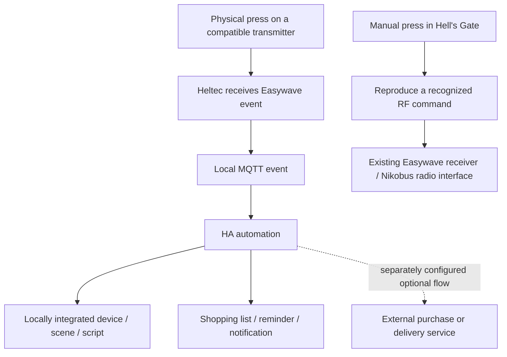

# Reusing wireless wall buttons for Home Assistant automations

You can use a compatible Easywave button as an HA input without pairing it with
an Easywave actuator or assigning it to a Nikobus output. The Heltec receives the
press and publishes an event; HA runs the configured action. The trigger uses the
received identity, so names and rooms are optional.

Received RF identities are observable and potentially replayable. Read the [security
chapter](SECURITY.md) before assigning consequential actions. A button event alone is
not proof that an authorized person requested the action.

The two paths are:



For the automation path, you need a compatible button, the gateway, HA and the
target's integration. No Nikobus cabinet or Easywave actuator is needed. The
controlled device can use any protocol supported by its own HA integration.

## The laundry-supplies example

Use button 1 for laundry detergent and button 2 for fabric softener. The example
adds the product to an HA shopping list. An ordering workflow would need a separate
retailer integration, account and payment/confirmation setup; Hell's Gate itself
has no retailer connector and places no orders.

Add HA's Shopping List or Local to-do integration, create an automation and replace the
two received IDs and to-do entity below. These are placeholders because IDs and entity
names belong to each installation.

```yaml
alias: "Laundry supplies from two wall buttons"
description: "Map received button identities to items in a local HA shopping list."
triggers:
  - trigger: mqtt
    topic: nikobus/easywave/rx/event
    value_template: "{{ value_json.identity }}"
    payload: REPLACE_WITH_BUTTON_1_ID
    id: detergent
  - trigger: mqtt
    topic: nikobus/easywave/rx/event
    value_template: "{{ value_json.identity }}"
    payload: REPLACE_WITH_BUTTON_2_ID
    id: softener
actions:
  - action: todo.add_item
    target:
      entity_id: todo.replace_with_my_shopping_list
    data:
      item: "{{ 'Laundry detergent' if trigger.id == 'detergent' else 'Fabric softener' }}"
  - delay:
      milliseconds: 750
mode: single
max_exceeded: silent
```

The short delay suppresses additional triggers while this automation is running. It also
suppresses legitimate very rapid repeated presses. Tune it against actual observations;
it does not identify every RF retransmission or human gesture perfectly. The list can
still contain repeated products after separate intentional presses.

The example uses the documented [`todo.add_item`
action](https://www.home-assistant.io/integrations/todo/) with an entity supplied by a
[to-do/shopping-list
integration](https://www.home-assistant.io/integrations/shopping_list/). The action adds an item to the list.

## Adjusting a thermostat with two buttons

Use one side of a two-way button to increase a setpoint and the other side to decrease
it. Pressing the physical switch triggers HA in the background, without opening a phone,
browser or HA dashboard for each change.

HA, MQTT and the thermostat integration must be running. With a local target
integration, Internet access is unnecessary. The automation stops working during
an HA outage.

```yaml
alias: "Thermostat adjustment from a two-way wall button"
triggers:
  - trigger: mqtt
    topic: nikobus/easywave/rx/event
    value_template: "{{ value_json.identity }}"
    payload: REPLACE_WITH_INCREASE_BUTTON_ID
    id: increase
  - trigger: mqtt
    topic: nikobus/easywave/rx/event
    value_template: "{{ value_json.identity }}"
    payload: REPLACE_WITH_DECREASE_BUTTON_ID
    id: decrease
actions:
  - variables:
      current: "{{ state_attr('climate.replace_with_my_thermostat', 'temperature') }}"
      minimum: "{{ state_attr('climate.replace_with_my_thermostat', 'min_temp') }}"
      maximum: "{{ state_attr('climate.replace_with_my_thermostat', 'max_temp') }}"
      step: "{{ state_attr('climate.replace_with_my_thermostat', 'target_temp_step') | float(0.5) }}"
  - condition: template
    value_template: "{{ current is number and minimum is number and maximum is number }}"
  - variables:
      requested: "{{ current | float + (step | float if trigger.id == 'increase' else -(step | float)) }}"
  - action: climate.set_temperature
    target:
      entity_id: climate.replace_with_my_thermostat
    data:
      temperature: "{{ [maximum | float, [minimum | float, requested | float] | max] | min | round(2) }}"
  - delay:
      milliseconds: 750
mode: single
max_exceeded: silent
```

The example uses the target's reported step and bounds, and stops when a usable current
single setpoint is absent. Adapt it for climate devices exposing upper/lower target
ranges instead of a single `temperature` attribute. Retain the device's independent
temperature and heating protections.

The action is HA's
[`climate.set_temperature`](https://www.home-assistant.io/integrations/climate/). The
actual entity, supported features and setpoint behavior depend on the integration. These
examples are offline-checked configuration examples, not automations installed or
physically tested in another household.

## More button uses

| Input | HA action | Target-side requirements |
|---|---|---|
| Bedside button | Activate a bedtime scene: lights, selected plugs and a quiet media preset. | The corresponding locally integrated entities and a scene/script. |
| Entrance button | Run a chosen “leaving” scene for nonessential lights and equipment. | Explicitly selected targets; this press alone does not establish presence. |
| Two-way living-room button | Raise/lower a dimmer or choose two lighting scenes. | A dimmable HA light, regardless of its own radio technology. |
| Two-way button beside a sofa | Increase/decrease speaker volume, or use two preset levels. | A compatible media-player integration. |
| Spare button | Pause/resume media or mute a speaker. | The target's supported media actions. |
| Two-way window-side button | Open/close a blind, or move it to two preferred positions. | A locally integrated cover with the needed features. |
| Desk button | Switch a work scene, desk lamp or selected smart socket. | An HA light/switch/scene, with the appliance's own controls retained. |
| Button near the washing machine | Start a reminder timer or acknowledge a finished-cycle notification. | HA timer/script/notification entities. |
| Kitchen button | Start a tea/cooking timer or cycle through preset durations. | A timer and a small script; no specialized connected kitchen appliance. |
| Spare utility button | Add a household consumable to a to-do list. | An HA to-do entity; a retailer connector only if an external ordering flow is desired. |
| Button at a frequent exit | Acknowledge a bin-collection or maintenance reminder. | A reminder helper and automation. |
| Button on an unassigned plate | Send a household notification or a dinner-ready chime. | A local notification/audio endpoint. |
| Two-way ventilation button | Select two fan speeds or comfort presets. | A locally integrated fan/ventilation controller with supported actions. |
| Button beside a robot-vacuum dock | Start cleaning or return to the dock. | A vacuum integration exposing those commands. |
| Garden-side button | Run a bounded irrigation script or stop that manual cycle. | A compatible valve/controller and a script with a defined stop behavior. |
| Guest-room button | Select a clear comfort scene without handing a guest the HA interface. | A deliberately limited scene/script. |
| Reused button in a rented room | Control existing HA devices without changing the original receiver pairing. | A compatible wireless transmitter and reachable target integrations. |
| Workshop button | Start a task timer, set a focus light, or record a completed routine. | HA helpers/scripts; the button is not an emergency-stop replacement. |

These applications use HA's existing action model. Configure generic actions through
native HA MQTT-triggered automations; the Hell’s Gate card does not supply a dedicated
editor for each action. The card focuses on discovery, naming, grouping and direct
reproduction of recognized RF commands.

## Choosing input and output hardware

Choose a compatible input button by its feel, appearance, power source, price and
availability. HA can then control equipment from another manufacturer through
its own integration. Include the gateway and actuator when comparing total costs.

Hell's Gate decodes the studied Easywave FSK family. A matching frequency or
brand name is insufficient to establish compatibility. Zigbee, Z-Wave, BLE, Matter
and other input protocols need their own receiver/integration. Once their button
events reach HA, the same automation patterns can be used.

The opposite direction—third-party HA inputs reproducing a recognized command toward an
existing Nikobus RF interface—and distinct ON/OFF buttons are described in
[NIKOBUS_INTEROPERABILITY.md](NIKOBUS_INTEROPERABILITY.md). Requested state stays
separate from measured state even when commands are explicit.
